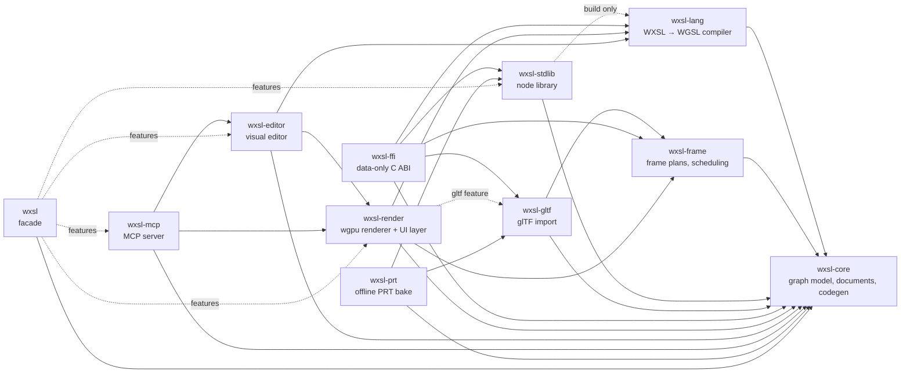

# Architecture

How the pieces fit together. Each section is a summary that links to the
ADR holding the reasoning and to the module holding the detail. When this
file and an ADR disagree, the ADR wins; fix this file.

## In one paragraph

A material is a **node graph** (authored in the editor, in code, or as a
JSON document). It compiles to **WXSL**, which `wxsl-lang` lowers to WGSL.
A **pipeline** is another graph, over a vocabulary of passes and resources,
which compiles to a list of passes the scheduler orders and allocates. One
material graph compiles into every pass that draws it, so forward,
deferred, shadows and motion vectors never require the author to write
anything twice. Everything up to the device is device-free Rust, shared by
two backends: wgpu in Rust, and Dawn in C++ through a data-only C ABI.

## Crates

Arrows point from dependent to dependency.
[ADR 0002](adr/0002-cargo-workspace-crate-boundaries.md) explains the split
and lists which edges must never appear. Three edges need explaining:

- **`stdlib → lang` is build-only.** Nodes are derived from their `.wxsl`
  files at build time, so the shipped library carries no compiler
  ([ADR 0020](adr/0020-a-node-definition-is-derived-from-its-wxsl-source.md)).
- **`editor → render`.** The editor draws itself with the renderer
  ([ADR 0013](adr/0013-the-editor-draws-itself-with-wxsl-render.md)).
- **`editor → lang`.** The code panels reuse the compiler's lexer for
  syntax highlighting
  ([ADR 0016](adr/0016-syntax-highlighting-reuses-wxsl-langs-lexer.md)).
- **`wxsl-gltf` takes the registry as an argument.** It never depends on
  `wxsl-stdlib`, so `wxsl-render` can reuse its geometry reader and C++
  gets the same import through `wxsl-ffi`
  ([ADR 0080](adr/0080-gltf-import-produces-a-scene-document-with-generated-graphs.md)).

- **`wxsl-prt` is an offline tool.** It bakes precomputed radiance
  transfer on the CPU and rewrites imported graphs to read it. No other
  crate depends on it; the `viewer` example uses it as a dev-dependency
  ([ADR 0092](adr/0092-precomputed-radiance-transfer-is-baked-offline-and-applied-as-environment-occlusion.md)).

`wxsl-core`, `wxsl-frame`, `wxsl-lang`, `wxsl-gltf`, `wxsl-prt` and
`wxsl-ffi` never touch a device.
That is what lets the scheduler, layouts and compiler be tested in CI
without a GPU, and shared with Dawn
([ADR 0048](adr/0048-the-frame-plan-is-device-free.md)).

### Facade features

| Feature | Default | Adds |
|---|---|---|
| `render` | on | `wxsl-render` |
| `stdlib` | on | `wxsl-stdlib`, and `wxsl::stdlib_library()` to hand it to the renderer |
| `editor` | off | `wxsl-editor` (implies `render`) |
| `images` | off | PNG and JPEG decoding for scene textures (implies `render`) |
| `gltf` | off | glTF/GLB import: `file` meshes, and with `stdlib` whole scenes through `wxsl::asset` (implies `images`) |
| `webgl` | off | wgpu's WebGL2 backend on `wasm32` |
| `mcp` | off | `wxsl-mcp`, an MCP server over the editor's commands (implies `editor`) |

With `default-features = false`, `wxsl` is the graph model alone: no wgpu,
no GUI. The renderer ships no shaders of its own; the application supplies
a `ShaderLibrary` ([ADR 0009](adr/0009-the-application-supplies-the-shader-library.md)).

## Documents

Everything a user authors is a versioned JSON document. Each one carries
`version` and `abi` fields. A missing field means "this build". A version
newer than the build is refused by name. Saving stamps both fields. Registry
ids are namespaced `package.name`
([ADR 0044](adr/0044-identity-versions-and-the-capability-check.md)).

There is **one graph model with three domains**
([ADR 0040](adr/0040-screen-domain-graphs-postprocess-is-a-material-over-the-frame.md)).
A node definition lists the domains it may appear in, and
`NodeRegistry::in_domain` filters the palette.

| Domain | Graph means | Compiled by | Into |
|---|---|---|---|
| `surface` | a material | `codegen::generate` | one module per material stage |
| `screen` | a post effect | `codegen::generate_screen` | one fullscreen pass |
| `document` | a pipeline | `wxsl_frame::pipeline_doc::compile` | a `FrameGraph` |

The **scene document** (`wxsl_core::scene`) lists the meshes, materials and
instances that exist, and says nothing about how they are drawn
([ADR 0021](adr/0021-a-declarative-render-graph-and-a-scene-document.md)).
`RenderSetup::check` checks a scene against the pipeline it will run
under, and reports every mismatch.

## Materials

### Terminals and stages

A material graph has several outputs:

- **`output.surface`**, required: a `Surface` (base colour, metallic,
  roughness, normal, emissive, occlusion, alpha).
- **`output.vertex`**, optional: an object-space offset added to each
  vertex.
- **`output.discard`**, optional: an alpha test.
- **`output.fragment`**, optional: the colour written in place of the lit
  surface, fed from `output.surface`'s `color` output through any nodes
  (fog, a grade). Under deferred such a material shades forward
  ([ADR 0089](adr/0089-the-surface-output-hands-its-shaded-colour-to-a-fragment-output.md)).
- **`output.varying`**, one per declared interpolant
  ([ADR 0027](adr/0027-a-graph-computes-its-own-interpolants.md)).

Codegen partitions the graph by what each output reaches. A **material
stage** decides which parts are compiled: a depth or shadow pass gets the
vertex offset and the discard test, never the shading. That is why a
displaced object casts a displaced shadow
([ADR 0025](adr/0025-a-material-graph-spans-shader-stages.md)).

Stages are rows in `abi::MATERIAL_STAGES`:

- `forward_lit`, `gbuffer`, `depth_only`;
- `velocity` ([ADR 0046](adr/0046-velocity-is-a-stage-taa-is-a-policyd-chain.md));
- the peel and refraction stages.

A pass names its stage; the graph never does
([ADR 0022](adr/0022-material-stages-replace-the-render-path-enum.md)).

**Stage analysis** decides where each node runs
([ADR 0032](adr/0032-stage-analysis-computes-the-cut-between-stages.md)).
By default a node runs in the earliest stage that can produce it, and its
value crosses to the fragment stage as a synthesized interpolant. A node
that uses derivatives is fragment-only, and placing it anywhere else is a
named error
([ADR 0054](adr/0054-fragment-only-is-a-node-constraint-the-stage-analysis-checks.md)).

### What a material declares

`wxsl_core::resources::MaterialInterface` is computed from the reachable
graph. Codegen and the bind-group builder both read it, so the two cannot
disagree
([ADRs 0023](adr/0023-a-material-declares-its-resources.md),
[0024](adr/0024-a-material-declares-the-geometry-it-requires.md)).

- **Parameters** (`param.value`) are fields of a uniform buffer. Changing
  one is a buffer write, not a recompile. A `const`, by contrast, is
  inlined.
- **Textures and samplers** are bound by name.
- **The user block** is shaped by the material and filled by the
  application.
- **Attributes** come per vertex (a named mesh stream), per instance (a row
  supplied with the draw), or computed (the graph's vertex stage writes
  them).

There is no `#[repr(C)]` mirror of these layouts: `BufferLayout` computes
WGSL's alignment rules and is the only thing that knows them.

Everything that is configuration rather than a node is one value,
`MaterialConfig`:

- macros;
- the lighting model's name;
- the shadow flags;
- tags;
- forward shading;
- `max_layers`;
- feature channels.

`MaterialConfig::resolve` is the only place a name becomes an id
([ADR 0038](adr/0038-a-materials-configuration-is-one-value.md)).

### Macro variables

A value that must be known at compile time, such as a loop bound or a code
switch, is a macro (`wxsl_core::macros`).

- A `Flag` becomes an `@if` feature.
- An `Int` or `Float` becomes a module `const`.

Precedence, weakest first:

1. the file's default;
2. the node's default;
3. the graph's pin;
4. the application's override.

The whole set is part of the variant cache key.

## Lighting

**Lighting models** are WXSL functions with a fixed signature, under
`shaders/lighting/models/`, registered in `lighting::DEFAULT_MODELS`
([ADR 0028](adr/0028-lighting-models-dispatched-by-a-g-buffer-id.md)).

- A material names its model.
- A pipeline enables a `LightingSet`. The set determines:
  - the G-buffer layout;
  - the generated dispatch: a direct call when forward, a `switch` on the
    id the normal target carries when deferred;
  - the attachment-budget check.
- **Every model's data shares one target**, read by the pixel's id, so the
  G-buffer is 24 bytes per sample, or 32 with model data, whatever the set
  ([ADR 0088](adr/0088-one-shared-model-channel-and-the-id-in-the-normal-target.md)).
- **Material features** such as subsurface fill that target for the models
  that consume them ([ADR 0037](adr/0037-semantic-channels.md)).

The shading function, the G-buffer pack and the lighting pass are
generated from the set; never edit the generated text. Forward and deferred
call the same generated `shade_surface`, and tests assert they produce the
same image.

A material may also **shade forward under a deferred pipeline**. Its
radiance passes through the G-buffer unchanged. This is the route for
screen-space and derivative effects
([ADR 0056](adr/0056-a-material-may-shade-forward-under-either-pipeline.md)).

**Lights** come in two kinds:

- **Up to sixteen slots in the scene uniform**, for any type: directional,
  point, spot, rectangle. These lights can cast shadows, drawn into one
  depth atlas of shared tiles:
  - cascades for directional lights;
  - six faces for point lights;
  - sixteen samples for area lights;
  - cookies on spotlights.

  See ADRs [0026](adr/0026-shadows-a-view-per-light-and-two-flags-on-the-material.md),
  [0066](adr/0066-pack-shadow-slots-into-a-depth-atlas.md) and
  [0071–0073](adr/0071-fit-cascades-and-pack-point-shadow-faces.md).
- **Thousands of ranged lights without shadows.** The host bins them into a
  16 × 9 × 24 grid over the camera frustum
  ([ADR 0076](adr/0076-bin-ranged-lights-into-a-host-built-light-grid.md)).

**Ambient light and the environment** have three parts:

- **The split-sum BRDF table** is baked once by a compute effect
  ([ADR 0039](adr/0039-tonemap-is-an-effect-and-ambient-reads-the-lut.md)).
- **Environment cubes** are explicit frame resources, prefiltered from an
  HDR image or from the sky node through face passes
  ([ADRs 0062](adr/0062-prefilter-environments-through-parameterized-face-passes.md)–[0064](adr/0064-author-environment-bakes-and-depth-aware-backgrounds.md)).
- **Without them**, the analytic environment remains.

**Light stays linear** until the last pass. Every pass writes linear
radiance; the `tonemap` effect at the end of the chain applies the curve
and the display encoding
([ADR 0039](adr/0039-tonemap-is-an-effect-and-ambient-reads-the-lut.md)).
Nothing thresholds or blends encoded values.

## Pipelines

A pipeline is **data**: `PassDesc`s over `ResourceDesc`s, held in a
`FrameGraph` (`wxsl_frame`), which `wxsl_render`'s `RenderGraph` wraps
to record it on wgpu
([ADR 0021](adr/0021-a-declarative-render-graph-and-a-scene-document.md)).
It is usually authored as a document over the pipeline vocabulary
(`wxsl_core::pipeline`), which contains:

- sources;
- resources (`resource.color`, `resource.depth`, `resource.buffer`, …);
- passes (`pass.geometry`, `pass.shadow`, `pass.screen`, `pass.compute.*`,
  …);
- `output.present`.

The stock forward and deferred pipelines are preset documents in
`crates/wxsl-frame/assets/presets/`
([ADR 0033](adr/0033-pipelines-are-documents.md)). The hand-built
`forward_graph`/`deferred_graph` exist only as the reference the parity
tests compare against.

### Effects

An **effect** is a declared unit
([ADR 0034](adr/0034-effects-are-first-class-units.md)). It has:

- inputs and outputs, in binding order;
- a screen or compute entry point;
- a shader (a `.wxsl` file, generated, or a screen graph);
- **parameters** declared as `{name, default}`. Their uniform layout is
  computed, and the host tunes them through `Renderer::set_pass_param`
  without recompiling
  ([ADR 0042](adr/0042-effect-parameters-are-uniforms-the-descriptor-declares-them.md)).

A pass names an effect by id. A compute effect, or a screen effect with
unusual wiring, gets a derived `pass.compute.<id>` or `pass.screen.<id>`
node whose sockets are its declaration
([ADR 0041](adr/0041-compute-and-buffers-join-the-document-vocabulary.md)).
Applications register more effects with `Renderer::add_effect`. A
multi-pass pyramid such as bloom or depth of field is a single document
node that expands with scoped names
([ADR 0065](adr/0065-a-pyramid-is-one-document-node-with-scoped-names.md)).

### Scheduling

`FrameGraph::schedule` is pure and tested without a device. It:

- orders passes by what they read and write, with declaration order as the
  tie-break;
- validates everything it can check: attachment counts, formats, cycles,
  resources nothing writes;
- assigns physical textures.

Resource properties:

- **Persistence:** `Transient` textures are reused once their last reader
  has run. `Persistent { history: n }` keeps a ring, so a pass can read
  earlier frames without creating a cycle.
- **Shape:** textures may be 2D, arrays, cubes or 3D, with mips
  ([ADR 0061](adr/0061-texture-mips-and-attachment-subresources-are-frame-data.md)).
- **Buffers** are resources too, and never alias
  ([ADR 0036](adr/0036-buffers-are-graph-resources.md)).

A pass has a **policy**: per frame, once, on resize or on demand. A
non-default policy may only write stable storage
([ADR 0035](adr/0035-execution-policies.md)).

### Patterns built on these

- **Bakes.** A material subgraph is turned into a compute effect that
  writes a host-owned table. The material then samples that table
  ([ADR 0045](adr/0045-a-bake-is-an-effect-over-a-material-subgraph.md)).
- **Motion.** The velocity stage reads this frame's and the previous
  frame's transforms. TAA and motion blur are history chains over it
  ([ADR 0046](adr/0046-velocity-is-a-stage-taa-is-a-policyd-chain.md)).
- **Transparency.**
  - It is tiered: sorted by default, with dual depth peeling up to a
    material's `max_layers`
    ([ADRs 0047](adr/0047-dual-depth-peeling-and-the-baseline-native-split-for-blendable-float-targets.md),
    [0057](adr/0057-transparency-is-tiered-sorted-by-default-peeled-on-request.md)).
  - Draw order is data, per pass
    ([ADR 0055](adr/0055-sorting-is-opt-in-per-pass-and-it-sorts-draws-not-passes.md)).
  - Refraction composes peeled optical layers
    ([ADRs 0067](adr/0067-trace-refraction-through-peeled-surface-layers.md)–[0070](adr/0070-render-local-probe-glass-as-opaque-surfaces.md)).

### Switching pipeline

- `Renderer::set_pipeline` switches immediately and compiles during the
  next frame.
- `Renderer::request_pipeline` compiles the missing variants on a worker
  thread, keeps presenting the current pipeline, and then swaps.
  `swap_progress` reports how far it has got.

## A frame

The application gives the renderer three things:

- **an `Environment`:** the camera, lights, exposure and time. Positions
  are measured from an `f64` floating origin
  ([ADR 0074](adr/0074-rebase-each-frame-onto-an-f64-floating-origin.md));
- **a `DrawList`:** each item is a mesh, a material, a transform, tags,
  bindings and optionally a world box. A geometry pass draws a tag
  expression (`opaque && !outlined`);
- **a target view.**

The renderer never holds a scene. Converting a scene document into a draw
list is `wxsl_render::scene::SceneResources`'s job, a loader beside the
renderer that the facade re-exports as `wxsl::scene`
([ADR 0082](adr/0082-the-editors-scene-mode-and-scene-resources-in-the-renderer-crate.md)).
Large scenes split the work
([ADR 0086](adr/0086-large-scenes-instanced-runs-per-view-culling-shared-materials.md)):
the scene orders its draws by material and mesh and gives each a box; the
renderer draws adjacent identical draws as one instanced call, and skips a
draw whose box is outside a pass's view (the camera's or a shadow tile's).

**Bind groups** are allocated by update frequency
([ADR 0010](adr/0010-four-bind-groups-allocated-by-update-frequency.md)):

| # | Group | Holds |
|---|---|---|
| 0 | frame | camera, lights, shadow atlas, light grid, instance rows |
| 1 | material | the graph's declared parameters and textures |
| 2 | user | the application's block, if the material declares one |
| 3 | pass | what the pass reads, then its effect parameters |

`abi::BIND_GROUPS` is the single declaration of these groups. The fixed
host layouts (scene uniform, lights, vertices) are generated as Rust, C and
WXSL from `wxsl_core::host`
([ADR 0050](adr/0050-host-shared-layouts-are-generated.md)).

## Backends and profiles

- **wgpu** (`wxsl-render`) allocates pools, records passes and caches
  variants. The neutral ↔ wgpu type mapping is exhaustive (`types`).
- **Dawn** (`dawn/`) implements only the device half in C++
  ([ADR 0051](adr/0051-dawn-implements-only-the-device-half.md)). It
  consumes plans, WGSL and layouts exported by `wxsl-ffi` (JSON in, data
  out, [ADR 0049](adr/0049-share-the-core-through-a-data-only-c-abi.md)), or
  loads that ABI at runtime to compile
  ([ADR 0052](adr/0052-runtime-compilation-stays-behind-the-data-abi.md)).
  The C++ never reimplements scheduling, compilation or layouts. Parity
  scripts compare its images with wgpu's.
- **The profile is decided by the device, not by a feature**
  ([ADR 0075](adr/0075-webgl2-and-gl-are-a-fallback-profile.md)). Without
  compute or storage buffers (WebGL2, GLES):
  - instance rows are read from data textures;
  - compute effects that have a fragment form run as screen passes;
  - native-only effects are refused by name.

The release gate compiles and validates every shipped shader through the C
ABI under every profile
([ADR 0077](adr/0077-gate-a-release-on-every-shipped-shader-through-the-c-abi.md)).

## The editor

The editor draws itself with the renderer: its chrome is a WXSL shader, its
text is MSDF generated in-tree, and its preview is the real `Renderer` on
the real pipelines ([ADRs 0013](adr/0013-the-editor-draws-itself-with-wxsl-render.md),
[0014](adr/0014-msdf-text-with-an-own-generator-and-app-supplied-fonts.md)).

It is windowing-agnostic: it takes `UiEvent`s and records into an encoder.
`examples/editor.rs` is the winit glue.

It has three canvas modes over one renderer:

- **the material graph;**
- **the pipeline document,** compiled live on every edit
  ([ADR 0043](adr/0043-the-pipeline-canvas-is-a-mode-and-compiles-on-every-edit.md));
- **the scene:** a `.scene.json` or an imported glTF file in a viewport,
  with an outliner and an inspector. A click picks an instance on the CPU
  and opens its material in the material canvas, whose edits recompile
  that material in the scene
  ([ADR 0082](adr/0082-the-editors-scene-mode-and-scene-resources-in-the-renderer-crate.md)).

It also offers pass stepping, resource inspection and shader hot reload.

Every change to a document is a serializable `Command`, applied by
`Editor::apply`; the UI's gestures emit them too. Undo restores a snapshot
taken before each command, and `Query` is the read-only side
([ADR 0081](adr/0081-commands-are-the-editors-single-mutation-path.md)).

`wxsl-mcp` serves those commands and queries to agents over the Model
Context Protocol, on local HTTP beside the window or on stdio with no
window. Its transport threads plan each call and hand it to the render
thread, which the host drains once per frame with `Server::serve`. An
agent's steps are marked in the history, and its paths stay under a
project root
([ADR 0083](adr/0083-an-mcp-server-over-the-editors-commands.md)). An
agent learns the vocabulary from two resources that cannot drift: a node
reference generated from the registries (also `docs/reference/nodes.md`)
and an authoring guide whose snippets are run as tests. A function it
writes is validated by the device when saved, and an invalid shader is a
reported error, never a panic
([ADR 0084](adr/0084-wxsl-an-agent-can-write.md)).

Debugging a scene uses the same queries
([ADR 0085](adr/0085-scene-debugging-views-a-generic-probe-and-the-frame-panel.md)).
- **Surface views** (albedo, normal, uv, mip level, instance and
  material ids, ...) replace the shading function in a forward stage, and
  the lighting pass's output in deferred.
- **Frame views** (light count per cluster, cascades, shadow atlas) are
  editor effects appended to the running pass list. Wireframe is the
  renderer's line rasterization of the camera's passes; overdraw rewrites
  the forward passes to add a constant without a depth test.
- **The pixel probe** reads every texture layer and buffer a frame
  writes, right after the pass that writes it, so it works on any pass
  list.
- **The frame panel** lists each pass's time, draws and triangles.

## WXSL and the compiler

WGSL has no imports, no conditional compilation and no generics; the node
library needs all three. WXSL adds templates, imports, `@if` and
`@macro const`
([ADR 0011](adr/0011-own-the-shading-language.md), superseding the WESL
dependency of [ADR 0003](adr/0003-wesl-as-the-shading-language.md)).

`wxsl-lang` runs these passes, in this order:

| Pass | Job |
|---|---|
| `lexer` | tokens, plus template disambiguation |
| `grammar` | LALRPOP, over the token stream |
| `cond` | evaluates `@if` and binds macros, per module, before renaming |
| `resolve` | inlines imports and mangles names by origin |
| `mono` | instantiates templates on the flat module ([ADR 0012](adr/0012-monomorphize-templates-on-the-flat-module.md)) |
| dead-code elimination | keeps only what the root reaches |
| `emit` | WGSL; refuses anything that is still WXSL |

The order is an invariant, and `resolve` enforces it. `node` sits off this
pipeline: it parses one file and returns the `NodeDefinition` that file
describes.

`wxsl-lang` does not validate its WGSL output. The device, naga in tests,
or the release gate does.

## The node library

`wxsl-stdlib/shaders/<category>/` holds one `.wxsl` file per node, and **the
file is the node** ([ADR 0020](adr/0020-a-node-definition-is-derived-from-its-wxsl-source.md)):

- the signature gives the sockets;
- the type-parameter bounds give the generic types;
- the comments give the label, the doc and the defaults.

Arithmetic operators are inline expressions, one generic node per
operation ([ADR 0018](adr/0018-one-generic-node-per-operation.md)).
`shaders/wxsl/` holds the shader ABI
([ADR 0008](adr/0008-surface-graphs-and-a-named-shader-abi.md)) rather
than nodes.

The code is original or ported from audited permissive sources
([ADR 0053](adr/0053-permissive-shader-ports-retain-their-provenance.md)).
The authoring rules are in `crates/wxsl-stdlib/shaders/README.md`.

## See also

- [`glossary.md`](glossary.md): the terms used here.
- [`adr/README.md`](adr/README.md): the decision log.
- [`../AGENTS.md`](../AGENTS.md): commands, tests, conventions.
